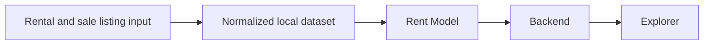

# rent-yield

`rent-yield` is a monorepo for a fullstack real estate application focused on helping users explore residential properties through rental return signals.

The first version is centered on a simple visual workflow:

1. Select an area on a map.
2. Load the properties in that area.
3. Rank those properties on a chart by `gross rent yield`.

## Why This Exists

Real estate users can often find sale prices and rent estimates, but they usually cannot compare properties in one area through a single clear investment-oriented visual ranking.

`rent-yield` is designed to close that gap with a map-plus-chart explorer that helps answer:

`In this area, which properties appear to offer the strongest rental return relative to their sale price?`

## Version One

Version one is intentionally narrow.

- Geography: `Colombia`
- First supported region: `Barranquilla`
- Core view: `map + ranked property chart`
- Primary metric: `gross rent yield`
- Secondary metric in domain only: `sale-to-rent ratio`
- No authentication in v1
- No advanced underwriting in v1

## Product Principles

- The map answers `where`.
- The chart answers `which`.
- The default metric should be easy to interpret.
- Estimated values should be labeled clearly.
- Version one should stay ergonomically simple.

## How Data Reaches the Explorer

The first data path is intentionally direct:



Listing input may begin as a small checked-in CSV or JSON dataset, or a
developer-invoked import. Rental listings provide comparable rent; sale
listings provide the properties to rank. The Rent Model estimates comparable
rent per square metre, and the backend serves the resulting yield ranking to
the Explorer.

The first developer-operated source-adapter boundary builds a local
`AdapterCandidate` JSON fixture into an adapter. It intentionally makes no
source request; see the [source-adapter builder guide](apps/crawlers/source-adapter-builder/README.md).

## Repository Structure

- `apps/frontend`: frontend application
- `apps/backend`: backend application
- `apps/rent-model`: standalone Rent Model input-contract workbench
- `docs`: specifications, plans, architecture, API contracts, reviews, and navigation

Start with [documentation navigation](docs/README.md) for implementation
references, or [plan navigation](docs/plans/README.md) for delivery work and plan
status.

## Specs

- [Frontend Product Spec](docs/specs/frontend-spec.md)
- [Frontend Interaction Spec](docs/specs/frontend-interaction-spec.md)
- [Shared Domain Spec](docs/specs/domain-spec.md)
- [Backend API Spec](docs/specs/backend-api-spec.md)
- [Rent Model Specification](docs/specs/rent-model-spec.md)

These specs are the current source of truth for product framing, domain language, and version-one scope.

## Active Decisions

- [Prototype v1 Frontend Tech Stack Decision](docs/decisions/prototype-v1-frontend-tech-stack-decision.md)

## Business Research

- [Business Model and Market Validation Plan](docs/plans/business-model-market-validation.md)
- [Business Model and Market Validation Memo](docs/research/business-model-market-validation.md)

## Rent Model

- [Rent Model V1 Plan](docs/plans/rent-model-v1.md)
- [Rent Model Specification](docs/specs/rent-model-spec.md)
- [Rent Model Workbench Guide](apps/rent-model/README.md)
- [Input Workbench Retrospective](docs/reviews/rent-model-input-workbench-retrospective.md)

## Development Approach

This repository is being developed through spec-driven development.

That means we define:

1. product behavior,
2. shared domain rules,
3. interaction design,
4. backend responsibilities,
5. implementation details.

In that order whenever possible.

## Project Tracking

Approved non-trivial plans are broken down into actionable Notion tasks after planning is complete.

The repo plan files in `docs/plans/` remain the source of truth for intent and decisions. Notion is used as the execution tracker for implementation slices, review, and documentation work.

Those Notion tasks should be written as small execution briefs, not placeholder tickets, so they can be understood from Notion alone during implementation.

## Current Status

The repository has a runnable frontend prototype and a runnable backend
prototype API for the first Barranquilla explorer contract.

What already exists:

- monorepo structure
- initial README
- root agent context files
- frontend product spec
- frontend interaction spec
- shared domain spec
- frontend tech-stack decision
- runnable frontend prototype scaffold
- Barranquilla fake-data explorer layout
- prototype v1 ergonomics review
- backend prototype API contract
- backend prototype API implementation
- initial Rent Model input-contract workbench

What comes next:

- import a small set of Barranquilla rental and sale listings
- connect the Rent Model estimate to the backend and explorer ranking
- validate the ranking with users before adding collection automation

## Running The Frontend Prototype

From the repository root:

```sh
pnpm install
pnpm dev
```

Run the backend prototype API with:

```sh
pnpm dev:backend
```

The backend listens on `http://127.0.0.1:3001` by default and currently serves:

```text
GET /api/v1/explorer/bootstrap?country_code=CO&city_name=Barranquilla
GET /api/v1/explorer/areas/{area_id}
```

Run the current checks with:

```sh
pnpm check
pnpm --filter @rent-yield/frontend test:e2e
```

## Long-Term Direction

Future versions may expand into:

- richer area analytics
- more comparison tools
- better rent estimation workflows
- additional Colombian cities
- deeper financial modeling

## License

No license has been defined yet.
